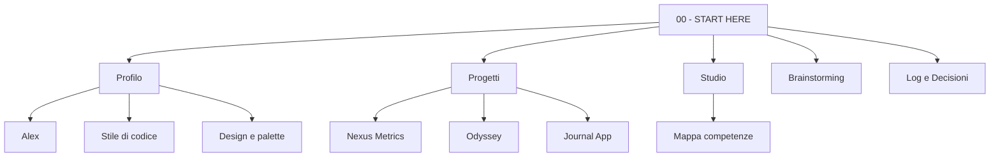

---
tags:
  - ai-context
  - moc
date: 2026-10-16
aggiornato: 2026-10-16
---
# AI Context — punto di ingresso

> [!abstract] A cosa serve
> Questa cartella è il **contesto condiviso** tra Alex e qualsiasi assistente AI (Claude, Codex, Antigravity, ecc.). Una nuova sessione legge **solo questa nota** e le note collegate che le servono, senza rileggere tutta la repo.
> È anche un vault Obsidian: apri la cartella `AI_Context` come vault e usa la vista grafo.

## Ordine di lettura per una nuova sessione AI

1. [[Regole per AI]] — cosa si può fare senza chiedere e cosa no.
2. [[Alex]] — chi è, obiettivo, livello attuale.
3. [[Stile di codice]] · [[Stile di pensiero e lavoro]] · [[Design e palette]] · [[Standard nuovo progetto]]
4. [[Registro lavoro]] — le ultime voci dicono a che punto siamo.
5. [[Registro decisioni]] — cosa è già stato deciso, da non rimettere in discussione.
6. Il progetto attivo (vedi sotto).

## Mappa

## Profilo
- [[Alex]]
- [[Stile di codice]]
- [[Stile di pensiero e lavoro]]
- [[Design e palette]]
- [[Workflow Git]]
- [[Standard nuovo progetto]] — come impostare ogni progetto nuovo

## Progetti esistenti
- [[Nexus Metrics]] — LoL, il più maturo (ingestion, analytics, dashboard Streamlit).
- [[Odyssey - Diario del Pendolare]] — web app Google Apps Script per i viaggi.
- [[Journal App]] — diario personale da terminale, Python OOP.
- [[FakeUni]] — generatore di dataset finto + esercizi pandas/SQL.
- [[EDA Personali]] — Spotify, Titanic, Stack Overflow survey.
- [[Chatbot Ristorante]] — chatbot e voicebot prenotazioni con backend e DB (ITS).
- [[Python Starter Kit]] — helper riutilizzabili (palette, EDA, ML, CNN).

## Studio
- [[Percorso ITS]]
- [[Materiale ITS AIRO2527]] — sintesi del Drive condiviso del corso
- [[Mappa competenze]]

## Progetto attivo
- **[[Diario Componibile]]** — ZibaldOne, comando `zibaldone` / `zbone` (idea B). Ricerca: [[2026-10-17 Progetti simili a ZibaldOne]]. nella repo `Desktop\ProjectTwoCode\Project-Two-Code`. In coda: Wardrobe (A) e Worldbuilding (D). Brainstorming: [[2026-10-17 Brainstorming da zero]] (archivio: [[2026-10-16 Brainstorming nuovo progetto]])

## Log e decisioni
- [[Registro lavoro]]
- [[Registro decisioni]]
- Template: [[Template sessione]] · [[Template decisione]]
