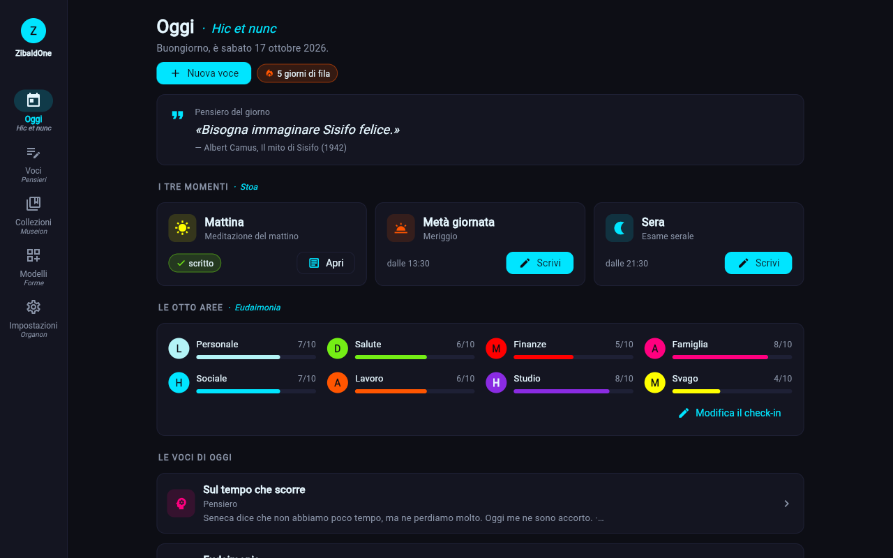
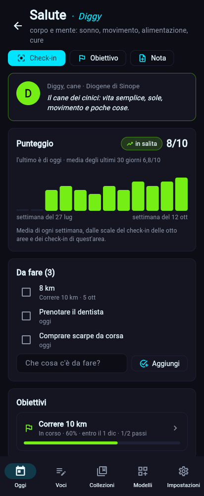

# 📔 ZibaldOne

Un **tutto in uno personale**, componibile e local-first: diario, collezioni, appunti, documenti, finanze e altro, costruiti a blocchi (testo, slider, voti, tag, segnalibri…) come vuoi tu. Per Windows e Android, in futuro Linux. Vedi la [visione](docs/tecnica/visione.md).

> Stato: **v0.2.5**, fase 0.2: le [8 aree della vita](docs/tecnica/aree.md) sono un concetto dell'app, con punteggio nel tempo, cose da fare e obiettivi per area, e le novità in arrivo; le [persone](docs/tecnica/persone.md) hanno ruoli, contatti, ritmo, legami tra loro, l'albero di famiglia, la rete di chi conosce chi e la pagina con tutto quello che le riguarda; i [segreti](docs/tecnica/segreti.md) (diario segreto, documenti, note mediche) sono cifrati con la tua chiave e si aprono con un PIN o la passphrase; foto, video, audio e documenti si [allegano](docs/tecnica/allegati.md) alle voci e finiscono, cifrati, nei backup; le [collezioni](docs/tecnica/svago.md) hanno date di inizio e fine, mezzi voti, preferiti e import da Goodreads, Letterboxd, MyAnimeList e Steam. Sotto c'è la fase 0.1 completa: ricerca, collegamenti, grafo, statistiche e revisioni delle voci, anonimizzatore per le future funzioni di IA, sopra la prima versione per i tester: interfaccia grafica per Windows e Android (APK nelle [release](https://github.com/KsandarIV/Project-Two-Code/releases)), modelli a blocchi, voci, modelli pronti, pacchetti da condividere, backup cifrati, accesso con Google e copie su Drive, promemoria per scrivere, avviso quando esce una versione nuova. Vedi la [roadmap](docs/tecnica/roadmap.md) e il [CHANGELOG](CHANGELOG.md).

## Avvio rapido (Windows, PowerShell)

```powershell
cd ZibaldOne
py -m venv .venv
.\.venv\Scripts\Activate.ps1
pip install -e ".[dev,ui]"
zbone app           # l'app, in una finestra (oppure: zbone app --web, nel browser)
zbone help          # i comandi del terminale (zbone è l'alias corto di zibaldone)
pytest
```

| Sul PC | Sul telefono |
|---|---|
|  |  |

## Privacy in una riga
Tutto ciò che scrivi resta **sul tuo dispositivo**. Nessun dato viene inviato a noi. I backup si cifrano con `zbone backup setup` e, se lo scegli, vanno cifrati anche sul tuo Google Drive; i blocchi segreti sono cifrati anche sul dispositivo e non entrano mai nella ricerca o nell'IA. Dettagli: [privacy e sicurezza](docs/tecnica/privacy-e-sicurezza.md).

## Documentazione
- [docs/](docs/README.md): indice di tutta la documentazione.
- [Guida per i tester](docs/utente/guida-tester.md): installare l'APK su Android e aggiornarlo.
- [Rilascio Android](docs/sviluppo/rilascio-android.md): come esce un APK.
