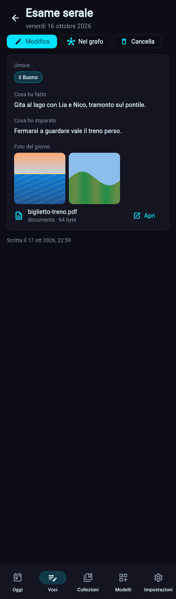

# Gli allegati · Mimesis (dalla 0.2.4)

La *mimesis* di Aristotele è l'arte che imita la vita, e così la ricorda. Un blocco **Allegati** (tipo `media`) tiene foto, video, audio e documenti di una voce o di una persona: la foto del giorno nella sera, il biglietto del treno, una nota vocale, la foto di chi ami.

## Dove stanno
- **Sul dispositivo**: nella cartella `media/` dentro la cartella dati, una volta sola per contenuto. Il nome del file è l'impronta SHA-256 del contenuto più l'estensione (`3f2a….jpg`): la stessa foto allegata a due voci occupa il posto di una.
- **Nella voce**: solo il nome (`{"file", "name", "size"}`), mai il contenuto. Il database resta piccolo.
- **Al massimo 100 MB** per file (si legge tutto in memoria per cifrarlo nei backup) e 50 allegati per blocco (`max_items`).
- Un file che nessuna voce nomina più si cancella da `media/` dopo un'ora (così un file scelto in un modulo ancora aperto non si perde). I backup conservano il loro.
- Sul dispositivo gli allegati restano **in chiaro**, come il database: si cifrano i backup e le copie fuori.

## Nei backup
- Ogni allegato va **una volta** accanto alle istantanee, come `backups/<file>.zbblob`: le istantanee non lo ricopiano ogni giorno.
- Con la cifratura attiva ogni copia è **cifrata** come le istantanee (X25519, AES-256-GCM); attivando la cifratura dopo, `Attiva la cifratura` cifra anche le copie già fatte.
- Ogni istantanea elenca i file che le servono, nel manifest e, se è cifrata, nell'intestazione pubblica: così la pulizia dei backup sa senza passphrase quali copie nessuna istantanea usa più, e le cancella (dopo un'ora). Chi ha i file dei backup vede quanti allegati ci sono e le loro impronte (non il contenuto): può solo confermare che hai un file che possiede già.
- **Verifica**: controlla che ogni allegato ci sia e che la sua impronta corrisponda. **Ripristino**: rimette in `media/` gli allegati che mancano.
- **Le Nuvole**: la sincronizzazione carica le copie cifrate che mancano fuori (prima delle istantanee, così un'istantanea fuori trova sempre i suoi file) e cancella quelle che nessuna istantanea fuori nomina più. Il recupero su un dispositivo nuovo scarica anche gli allegati dell'istantanea scelta.

## Nell'app
- **Modulo**: «Aggiungi file» apre la scelta dei file del sistema, anche più di uno; ogni file ha **Apri** e **Togli**.
- **Pagina della voce**: le foto in miniatura (si toccano per aprirle), gli altri file con **Apri**. Sul PC si aprono con il programma predefinito; sul telefono con il menu Condividi, da cui scegli l'app.
- Nell'editor dei modelli il blocco si chiama *Mimesis · Allegati*, con l'opzione *File al massimo*.

## Modelli con allegati
- **Stoa · Diario 1.1.0**: *Foto del giorno* nell'Esame serale (fino a 10), *Allegati* nel Pensiero.
- **Agorà · Persone 1.5.0**: *Foto e file* nella Persona, *Foto* nel Simposio.
- Le voci di prima restano valide: i pacchetti si aggiornano invece di installarsi come copia.

## Terminale
| Comando | Cosa fa |
|---|---|
| `zbone allegati` | quanti file e quanto spazio, e se ne manca qualcuno |
| `zbone allegati aggiungi 3f2a mare.jpg biglietto.pdf` | allega i file alla voce (`--blocco` se ne ha più di uno) |
| `zbone allegati mostra 3f2a` | gli allegati numerati, con il file sul disco |
| `zbone allegati salva 3f2a [2] --in Scrivania` | copia gli allegati (o solo il 2) in una cartella, con il loro nome |
| `zbone allegati togli 3f2a 2` | toglie l'allegato 2 |

`zbone entry add` salta i blocchi allegati; `zbone entry show` ne mostra i nomi.

## Limiti
- Video e audio non si riproducono dentro l'app: si aprono con il programma del sistema.
- La ricerca non guarda i nomi dei file né il loro contenuto; le esportazioni ne riportano solo i nomi.
- Nel browser (solo per provare l'app) i file si leggono interi in memoria.

## Codice
- `core/blocks.py` (`MediaBlock`, `media_kind`), `storage/media.py` (cartella `media/`, `remove_unused`), `storage/database.py` (controllo dei file nuovi e pulizia), `storage/backups.py` (copie `.zbblob`, verifica, ripristino, pulizia), `cloud/sync.py`.
- `ui/views/media_view.py` (miniature e righe), `ui/views/entry_form.py` (`MediaEditor`), `ui/context.py` (`pick_files`, `open_file`), `cli/media_cmd.py`.
- Test: `tests/test_media.py`, `tests/test_ui_views.py`, `tests/test_ui_logic.py`.
