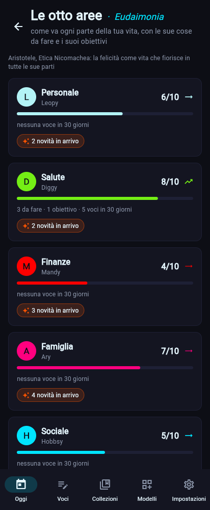

# Le 8 aree della vita · Eudaimonia (dalla 0.2.0)

*Eudaimonia* è la felicità di Aristotele (*Etica Nicomachea*): una vita che fiorisce in tutte le sue parti. Le otto aree sono **Personale, Salute, Finanze, Famiglia, Sociale, Lavoro, Studio, Svago**, ognuna con la sua mascotte ([identità](../brand/identita.md#le-mascotte)). Dalla 0.2.0 sono un concetto dell'app, non solo le scale di un modello: ogni modello e ogni voce può appartenere a un'area, e ogni area ha la sua pagina con punteggio nel tempo, cose da fare, obiettivi, check-in e note. Scelte: [ADR-0011](../decisioni/ADR-0011-aree-della-vita.md).

| Le otto aree | Un'area |
|---|---|
|  |  |

## A quale area appartiene una voce
1. L'**area della voce**, se l'utente l'ha scelta (`--area`, o "Area della vita" nel modulo).
2. In più, le aree scritte in un blocco *etichette* che si chiama `aree` (come nella Persona di Agorà): una persona può stare in Famiglia e in Lavoro insieme.
3. Per le persone, dalla 0.2.1, le aree del legame e dei ruoli: la madre in Famiglia, il capo in Lavoro ([le persone](persone.md)).
4. Solo se nessuna di queste dà un'area, l'**area del suo modello**: per esempio i libri vanno in Svago, lo sport in Salute, le persone senza ruoli in Sociale.

Una voce senza area non è sbagliata: semplicemente non compare nelle pagine delle aree. I nomi si scrivono come si vuole: `Salute`, `salute`, `health`, `soldi` (per Finanze), `amici` (per Sociale) vanno tutti bene.

L'archivio tiene la colonna `area` nelle voci e la tabella `entry_areas` (voce, area), riempita da sola a ogni salvataggio e all'aggiornamento dallo schema 2 (migrazione 3, con il backup prima). Così filtrare per area è un indice, non una lettura di tutte le voci.

## Punteggio da 0 a 10 nel tempo
Il punteggio di un'area viene da:
- le scale del check-in delle 8 aree (*Eudaimonia* di Stoa · Diario), che si chiamano come le aree;
- il blocco scala `punteggio` di una voce che ha un'area, come il check-in di una sola area (*Prosoché*).

Ogni scala viene riportata da 0 a 10, qualunque sia la sua scala (1–5, 0–100 …). La pagina dell'area mostra l'ultimo punteggio, la media degli ultimi 30 giorni, la **tendenza** rispetto ai 30 giorni prima (in salita, stabile, in discesa: conta solo una differenza di almeno mezzo punto) e un grafico con la media di ogni settimana delle ultime 12.

## Cose da fare
Le cose da fare di un'area sono le voci non spuntate dei blocchi *lista* delle sue voci, dalla più vecchia. Se lo stesso testo compare di nuovo in una voce più recente, vale il suo stato più recente (come nelle revisioni). Le cose aggiunte dalla pagina dell'area vanno nella lista dell'area (*Opere e giorni*, da Esiodo), creata la prima volta; spuntarle dalla pagina le spunta nella voce da cui vengono, con **Annulla** per tornare indietro.

## Obiettivi
Gli obiettivi sono le voci del modello *Telos* (`obiettivo`) dell'area: titolo, stato con avanzamento, scadenza, perché e passi. In cima quelli aperti, dalla scadenza più vicina; poi quelli completati o lasciati.

## La Scuola «Liceo · Aree»
Il pacchetto `aree` (si installa con Stoa · Diario al primo avvio, o con `zbone pack install aree`) porta tre modelli:

| Modello | Nome | Cosa contiene |
|---|---|---|
| `checkin_area` | Prosoché (l'attenzione a sé degli stoici) | punteggio 0–10, cosa va bene, cosa può andare meglio, nota |
| `obiettivo` | Telos (Aristotele: il fine) | titolo, stato, scadenza, perché, passi |
| `da_fare` | Opere e giorni (Esiodo) | la lista delle cose da fare, nota |

Collezioni, Io e Persone passano alla 1.1.0: i loro modelli hanno ora un'area (Svago per libri, film, serie, anime, giochi e musica; Salute per lo sport; Personale per il guardaroba e per Io; Sociale per persone e incontri). Reinstallarli aggiorna i modelli senza toccare le voci.

## «In arrivo»
Le pagine delle aree mostrano anche quello che non c'è ancora, con la versione prevista: per esempio il diario segreto in Personale (0.2.3), il bilancio cifrato in Finanze (0.2.6), le abitudini in Salute (0.2.7), e per tutte le aree la home su misura (0.2.8) e *Maieutica*, l'IA che fa domande sulle aree, dopo la 1.0. L'elenco è `UPCOMING` in `core/areas.py`: quando una versione esce, le sue righe si tolgono (un test controlla che ogni versione promessa sia ancora da fare).

## Dove si usa
- **App**: **Oggi → Aree** (o un riquadro delle aree in Oggi) apre le otto aree (`/aree`); un'area si apre con `/aree/<area>`. Da lì: **Check-in**, **Obiettivo** e **Nota** aprono il modulo con l'area già scelta (`/scrivi/<modello>/<area>`). In **Voci** c'è il filtro per area e la pagina di una voce mostra le sue aree; l'editor dei modelli ha "Area della vita delle sue voci".
- **CLI**: `zbone area` (le otto aree), `zbone area show salute`, `zbone area checkin salute -p 7`, `zbone area todo salute "prenotare il dentista"`, `zbone area fatto salute 1`; `--area` in `entry add/list/edit`, `template create`, `search`; `zbone template area libro svago` ([guida rapida](../utente/guida-rapida.md#le-otto-aree--eudaimonia)).
- **Esportazioni**: le aree della voce nelle proprietà Markdown (`areas:`) e la sua area principale nella colonna `area` dei CSV.

## Codice
- `core/areas.py`: le aree e i loro nomi, a quale area appartiene una voce, punteggi, cose da fare, obiettivi, riepilogo e pagina di un'area, «In arrivo», e le azioni su uno Store (check-in, aggiungere e spuntare). Funzioni pure con `today` sempre passato.
- `core/templates.py` (`area` in modello e voce, `check_area`), `storage/database.py` (migrazione 3, `entry_areas`, filtri per area).
- `ui/views/areas.py`, `ui/viewmodels.py` (`area_cards`, `area_page`, `upcoming_rows`), `cli/area_cmd.py`, `packs/aree.zbpack.json`.
- Test: `tests/test_areas.py`, `tests/test_ui_views.py`, `tests/test_export.py`, `tests/test_packs.py`.
