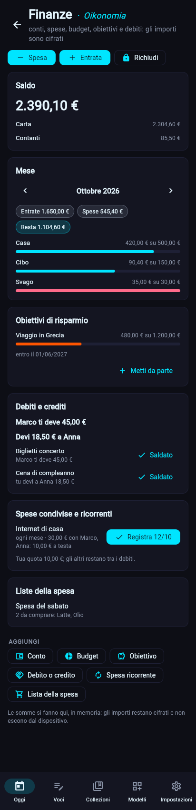

# Le finanze · Oikonomia (dalla 0.2.6)

*Oikonomia* è l'amministrazione della casa (*oikos*): conti, spese e entrate, budget, obiettivi di risparmio, debiti e crediti con le persone, spese condivise e la lista della spesa. È il modulo più delicato, quindi **ogni importo è cifrato** con la tua chiave ([ADR-0013](../decisioni/ADR-0013-importi-come-segreti.md)): ricerca, esportazioni, statistiche e IA non vedono mai un numero, solo le parole intorno («Affitto», «Cibo»).

## Come si usa
- **Installa** la Scuola **Oikonomia · Finanze** (nell'app: **Aree → Finanze → Apri il bilancio**, o `zbone pack install finanze`). Serve la cifratura dei backup attiva ([i segreti](segreti.md)).
- **Apri i conti** con il PIN (o la passphrase): gli importi si leggono solo da aperti e si richiudono dopo 5 minuti senza usarli, o con **Richiudi**.
- **Spesa** ed **Entrata**: importo, che cosa, categoria. Si scrivono anche a conti chiusi.
- Il bilancio mostra: il **saldo** (somma dei saldi iniziali dei conti e di tutti i movimenti, con il dettaglio per conto), il **mese** con entrate, spese e quanto resta, **per categoria** con la barra del budget (rossa se lo superi), gli **obiettivi** con **Metti da parte**, **debiti e crediti** con **Saldato**, le **spese condivise ricorrenti** con **Registra**, le **liste della spesa**.
- Gli importi si scrivono come si parla: `12`, `12,5`, `1.234,50`, `€ 12.50`. Al massimo due decimali.

## I modelli
| Modello | Soprannome | Blocchi |
|---|---|---|
| `conto` | Oikos | nome, tipo, saldo iniziale |
| `movimento` | Chrematistica | che cosa, Spesa o Entrata, importo, categoria, conto, note |
| `budget` | Giusto mezzo | categoria, importo al mese |
| `obiettivo_risparmio` | Formica | obiettivo, da raggiungere, messo da parte, entro il |
| `prestito` | Schuld | motivo, persona, *Mi deve* o *Gli devo*, importo, stato (Aperto, Saldato) |
| `spesa_ricorrente` | Koinonia | che cosa, totale, ogni settimana/mese/anno, dal, con chi la divido, categoria, ultima registrata |
| `lista_spesa` | Emporio | lista, voci da spuntare (nessun importo, quindi in chiaro) |

Categorie: Casa, Cibo, Trasporti, Salute, Svago, Studio, Lavoro, Regali, Stipendio, Altro. Le voci sono dell'area **Finanze**.

## Spese condivise
Una spesa ricorrente ha un totale, una frequenza, il giorno da cui parte e le persone con cui la dividi. Quando una scadenza arriva compare **Registra 12/10**: scrive la tua quota come spesa e un debito «Mi deve» per ogni altra persona (totale diviso in parti uguali; i centesimi che avanzano restano a te) e ricorda l'ultima scadenza registrata. Se salti dei mesi, le scadenze arretrate si registrano una alla volta (fino a 24). Il giorno 31 in un mese corto cade sull'ultimo giorno del mese. Pago sempre io: la 0.2 non tiene chi ha pagato altro.

I debiti stanno nella pagina della persona, come ogni voce che la collega. Non entrano nel saldo: saldarli non sposta soldi dai conti.

## Terminale
| Comando | Cosa fa |
|---|---|
| `zbone finanze` | saldo, mese per categoria con i budget, obiettivi (`--mese 2026-09`); chiede il PIN |
| `zbone finanze spesa 12,50 "Pizza" --categoria Cibo` | scrive una spesa (non serve il PIN); `--giorno AAAA-MM-GG` |
| `zbone finanze entrata 1500 "Stipendio" --categoria Stipendio` | scrive un'entrata |
| `zbone finanze debiti` | chi deve cosa a chi, con gli ID |
| `zbone finanze salda ID` | segna un debito come saldato |
| `zbone finanze ricorrenti [--registra]` | le spese ricorrenti e le scadenze arrivate; con `--registra` le scrive |

## Dentro il codice
- `core/finance.py`: importi (`parse_amount`, `canonical_amount`, `format_amount`, `Decimal` a due decimali), `load(store, reveal)` che apre gli importi con il caveau e dà un `Ledger`, le somme (`balance`, `month_summary`, `loan_balances`), le scadenze (`due_dates`) e le scritture (`add_movement`, `register_recurring`, `settle_loan`, `add_to_goal`).
- `SecretBlock` ha l'opzione `format` (`importo` o `saldo`); senza, è un testo qualsiasi come prima.
- `ui/views/finance.py` (rotte `/finanze` e `/finanze/AAAA-MM`) e `cli/finance_cmd.py`.

## Limiti
Una sola valuta (euro); nessun collegamento con le banche (i movimenti si scrivono a mano); nessun grafico del saldo nel tempo; le categorie sono fisse (un modello tuo può averne altre); le liste della spesa si spuntano aprendo la voce.
