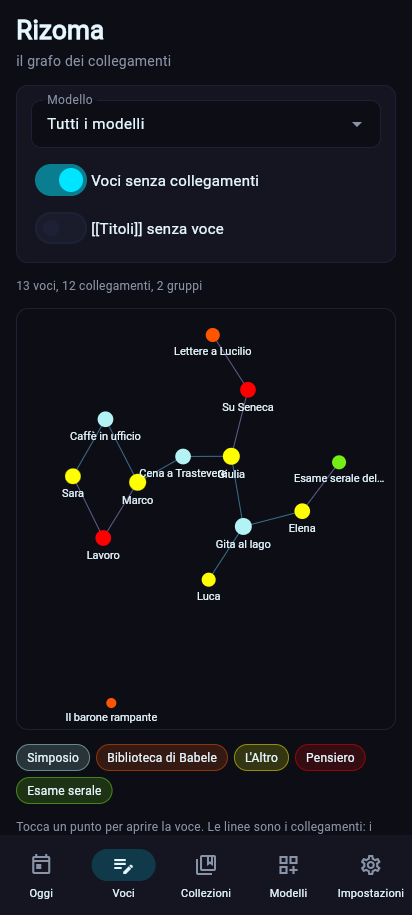

# Il grafo · Rizoma (dalla 0.1.3)

*Rizoma* viene da Deleuze e Guattari (*Mille piani*, 1980): una rete senza centro, dove ogni punto si può collegare a ogni altro. In ZibaldOne è la mappa delle voci e dei loro collegamenti, come il grafo di Obsidian.

## Cosa c'è nel grafo
- **Nodi**: le voci, colorate per modello (la legenda sotto il grafo). Più collegamenti ha una voce, più il punto è grande.
- **Linee**: i collegamenti della [ricerca e collegamenti](ricerca-e-collegamenti.md), cioè i blocchi «collegamento» e i `[[Titoli]]` nei testi. Due voci collegate più volte hanno una linea più spessa.
- **Su richiesta**: i `[[Titoli]]` che non hanno ancora una voce (cerchi vuoti), le voci senza collegamenti, e solo nella CLI le etichette e i modelli come nodi, o le voci con etichette in comune collegate tra loro.
- **Filtri**: per modello, date ed etichetta; **intorno a una voce** mostra solo le voci a 1, 2 o 3 passi da lei.

## Come si dispone
- `core/graph.py` calcola le posizioni con un algoritmo a forze (Fruchterman–Reingold, con una griglia per le repulsioni): le voci collegate si avvicinano, le altre si allontanano.
- Il risultato è **sempre lo stesso** per gli stessi dati (seme fisso, numero di passi limitato): il grafo non "balla" a ogni apertura.
- Ogni gruppo di voci collegate si dispone da solo, poi i gruppi si affiancano. Le posizioni sono tra 0 e 1, così l'app, la pagina HTML e il JSON mostrano lo stesso disegno.
- I passi dell'algoritmo calano con il numero di nodi (da 300 a un minimo di 30), per restare veloci anche con tante voci.

## Dove si usa
- **App**: in **Voci → Grafo**, o dalla pagina di una voce con **Nel grafo** (il grafo intorno a lei). Si tocca un punto per aprire la voce; sotto ci sono le voci più collegate. Il disegno è su una tela Flet (`ui/views/graph.py`), con i calcoli in `ui/viewmodels.py` (`draw_graph`, `nearest_node`).
- **CLI**: `zbone graph` stampa un riepilogo (voci, collegamenti, gruppi, le più collegate); `--html` salva una pagina da aprire nel browser, con zoom, spostamento e nomi al passaggio del mouse; `--json` salva nodi, linee e posizioni ([guida rapida](../utente/guida-rapida.md#il-grafo--rizoma)).
- La pagina HTML è un file solo, senza internet: SVG e un po' di JavaScript scritti dentro.

## Limiti
- Con migliaia di voci il disegno diventa fitto: i nomi compaiono solo per le voci più collegate. I filtri e "intorno a una voce" servono a questo.
- Nell'app non si può ancora spostare un punto a mano né fare zoom: arriveranno quando il grafo diventerà un modulo suo (vedi la [visione](visione.md)).
