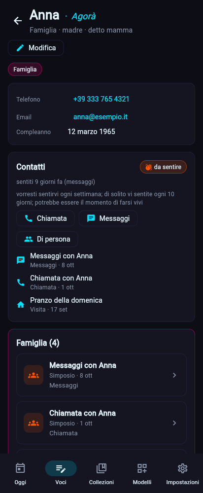
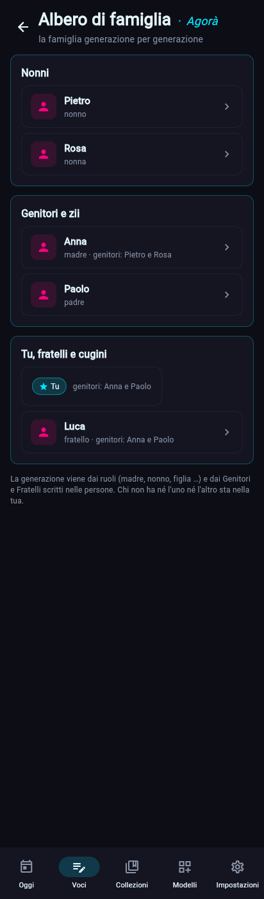
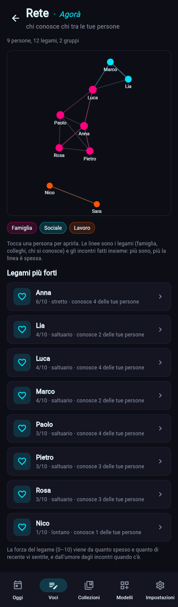

# Le persone · Agorà (dalla 0.2.1)

L'*agorà* era la piazza dove ci si incontrava. Una persona è una voce del modello *L'Altro* (`persona`); ogni *Simposio* (`incontro`) che la collega è un contatto con lei. Da qui vengono le sue aree, l'ultimo contatto, il ritmo e la pagina con **tutto di Marco**, area per area. Dalla 0.2.2 le persone sono legate tra loro: l'albero di famiglia, la rete di chi conosce chi, i contatti in comune e la forza del legame.

## Cosa ha una persona
| Blocco | Cosa contiene |
|---|---|
| Nome, Soprannomi | il titolo e i nomi con cui la citi (`[[Marchino]]`) |
| Legame (`ruolo`) | Famiglia, Amico, Collega, Mentore, Conoscente, Altro |
| Ruoli (`ruoli`) | ruoli di base (madre, capo, medico, commercialista …) o tuoi, quanti vuoi |
| Aree | altre aree a mano |
| Telefono, Email | controllati mentre li scrivi (blocco testo con `format`); nell'app si toccano per chiamare o scrivere |
| Social, Compleanno, Note | come prima |
| Ogni quanto sentirvi (`frequenza`) | ogni settimana … ogni anno |
| Genitori, Fratelli e sorelle, Colleghi, Conosce (`genitori`, `fratelli`, `colleghi`, `conosce`) | le altre persone a cui è legata (dalla 0.2.2, Agorà 1.3.0) |
| Indirizzo, Documenti, Salute (`indirizzo`, `documenti`, `salute`) | blocchi segreti, cifrati: l'indirizzo al livello protetto, documenti e salute al livello massimo (dalla 0.2.3, Agorà 1.4.0; [i segreti](segreti.md)) |

## In quali aree sta
Legame e ruoli di base mettono la persona nell'area giusta da soli: la madre in Famiglia, il capo in Lavoro, il medico in Salute, il commercialista in Finanze (l'elenco è in `core/roles.py`). I ruoli tuoi non danno un'area: per quelli c'è il blocco Aree. Sociale, l'area del modello, vale solo per chi non ne ha un'altra. Questa regola vale dalla 0.2.1 e l'indice delle aree si ricostruisce da solo all'apertura ([ADR-0011](../decisioni/ADR-0011-aree-della-vita.md)).

## Contatti e ritmo
- Un contatto è un Simposio che collega la persona; il blocco **Come** dice se era una chiamata, dei messaggi, un'uscita, una visita … (i Simposi di prima della 0.2.1 contano come "Incontro").
- **Ultimo contatto**: il giorno dell'ultimo Simposio con lei. **Ritmo**: la media dei giorni tra gli ultimi 10 contatti.
- **Da sentire**: chi ha un "Ogni quanto sentirvi" e non senti da almeno quel tempo. Le parole restano neutre ("potrebbe essere il momento di farsi vivi"), come vuole [ADR-0008](../decisioni/ADR-0008-notifiche.md); non arrivano notifiche.
- Segnare un contatto al volo (Chiamata, Messaggi, Di persona) crea un Simposio con il titolo già scritto ("Chiamata con Anna") nell'area principale della persona.

## Tutto di Marco
La pagina di una persona raccoglie ogni voce che la collega (blocchi collegamento e `[[Marco]]`) e la raggruppa per l'area di quella voce: gli incontri in Famiglia, il libro che ti ha prestato in Svago, le voci senza area in fondo. Sotto, i testi che la nominano senza collegarla.

## Legami, albero e rete (dalla 0.2.2)

| Albero di famiglia | Rete |
|---|---|
|  |  |

- **Legami**: genitore di, fratello o sorella di, collega di, conosce. Si scrivono da una parte sola e valgono nei due sensi: se Luca ha Anna tra i Genitori, Anna ha Luca tra i figli. Chi compare nello stesso Simposio si conosce anche senza scriverlo. Non serve una tabella nuova: sono blocchi collegamento, quindi compaiono anche nel grafo.
- **Albero di famiglia**: chi ha l'area Famiglia, un ruolo di famiglia o un legame di famiglia, generazione per generazione intorno a te. I ruoli dicono dove stanno rispetto a te (nonni due sopra, madre e zii uno sopra, fratelli e cugini con te, figli uno sotto; *nipote* no, perché vuol dire due cose); Genitori e Fratelli portano avanti la generazione (il nonno di Anna sta sopra Anna). Chi non ha né ruolo né legame sta nella tua generazione. Senza nessun ruolo, l'albero mostra solo le generazioni in ordine, senza di te.
- **Rete**: le persone come punti colorati per area, le linee sono i legami e gli incontri insieme (più sono, più è spessa), disegnata come il [grafo](grafo.md). Anche per una sola area: in Lavoro è la rete dei colleghi.
- **Contatti in comune**: per ogni legame di una persona, quante e quali persone conoscete entrambi.
- **Forza del legame** (0–10): ogni giorno di contatto conta, sempre meno con il tempo (metà dopo tre mesi); circa uno ogni due settimane, tenuto nel tempo, fa 10. L'umore degli ultimi Simposi vale un quinto. Le parole restano neutre: molto stretto, stretto, saltuario, lontano.

## Dove si usa
- **App**: nella pagina di un'area, il riquadro **Persone** (chi è da sentire ha il segno), con **Albero** in Famiglia e **Rete** dell'area; toccando una persona si apre `/persone/<id>`, con i suoi Legami. Dalla pagina di una voce Persona, **Tutto di Marco**. L'albero è `/albero`, la rete `/rete` o `/rete/<area>`.
- **CLI**: `zbone persona` (chi è da sentire per prima), `zbone persona list --area famiglia`, `zbone persona show marco`, `zbone persona sentito marco --tipo chiamata --nota "..."`, `zbone persona lega anna genitore luca`, `zbone persona albero`, `zbone persona rete [marco] [--area lavoro]` ([guida rapida](../utente/guida-rapida.md#le-persone--agorà)).

## Codice
- `core/roles.py` (ruoli e aree), `core/people.py` (persone, contatti, ritmo, pagina, `log_contact`), `core/relations.py` (legami, albero, rete, contatti in comune, forza del legame, `add_tie`), `core/areas.py` (`entry_areas` con i ruoli), `storage/database.py` (`AREA_RULES`).
- `ui/views/people.py` (persona, albero, rete), `ui/viewmodels.py` (`person_view`, `people_rows`, `family_tree_rows`, `network_view`), `cli/person_cmd.py`, `packs/persone.zbpack.json` (Agorà 1.4.0).
- Test: `tests/test_people.py`, `tests/test_relations.py`, `tests/test_ui_views.py`.
