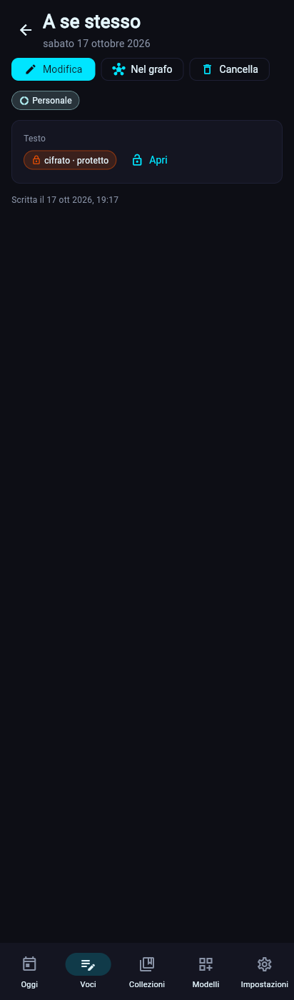
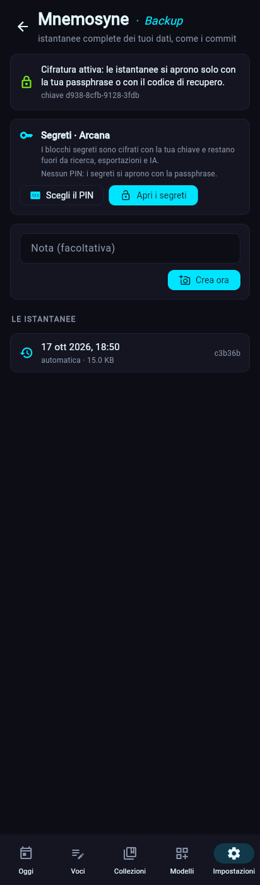

# I segreti · Arcana (dalla 0.2.3)

Gli *arcana* erano le cose nascoste, riservate a chi era iniziato. In ZibaldOne un **blocco segreto** (tipo `secret`, soprannome *Echemythia*, il silenzio dei pitagorici) tiene un testo che non resta mai in chiaro: documenti, indirizzi, note mediche, il diario segreto. Il resto della voce resta normale e si cerca come sempre.

## Come funziona
- **Si cifra prima di salvare.** L'archivio (`Store.add_entry`, `update_entry`) cifra ogni blocco segreto scritto in chiaro, poi controlla che nessun segreto sia rimasto leggibile (`check_sealed`); se manca la chiave, non salva nulla e lo dice.
- **Stessa cifratura dei backup** (`core/crypto.py`: X25519, HKDF-SHA256, AES-256-GCM). Nel database un segreto è `zbs1:` seguito dal testo cifrato in base64; il livello e la chiave che lo apre sono nell'intestazione, autenticata.
- **Scrivere non chiede nulla**: per cifrare bastano le chiavi pubbliche, salvate in `keys.json`. Solo **leggere** chiede il PIN o la passphrase.
- **Fuori da tutto**: ricerca, collegamenti, statistiche, esportazioni (Markdown e CSV), anonimizzatore e IA leggono `to_text`, che per un segreto è solo «🔒 cifrato». La ricerca di una parola del segreto non trova la voce.

## Due livelli
| Livello | Si apre con | Chiave | Per |
|---|---|---|---|
| **protetto** (di base) | il PIN o la passphrase | la chiave «di tutti i giorni», ricavata dalla chiave dei backup con HKDF | il diario segreto, gli indirizzi |
| **massimo** | solo la passphrase (o il codice di recupero) | la chiave dei backup | documenti, note mediche |

La chiave del livello protetto si ricava sempre uguale dalla chiave dei backup: chi può aprire i backup (passphrase o codice di recupero, anche su un dispositivo nuovo) può aprire anche tutti i segreti. Le chiavi esistono solo in `keys.json`, che non è dentro i backup.

Chi aveva attivato la cifratura prima della 0.2.3 apre i segreti una volta con la passphrase (nell'app **Impostazioni · Mnemosyne → Apri i segreti**, o `zbone segreti apri`): da lì i segreti protetti si scrivono senza chiedere nulla. Quelli di livello massimo si scrivono subito.

## Il PIN
- Da 6 a 12 cifre. Apre **solo** il livello protetto: mai il livello massimo, mai i backup.
- Si sceglie dopo la passphrase (**Impostazioni · Mnemosyne → Scegli il PIN**, o `zbone segreti pin`) e si toglie quando vuoi (`zbone segreti pin --togli`).
- Dopo **5 PIN sbagliati di fila** il PIN si toglie da solo: poi serve la passphrase, e se ne sceglie uno nuovo.
- È una comodità, non una cassaforte: chi copia `keys.json` può provare tutti i PIN su un altro computer. Per questo il PIN usa scrypt più pesante della passphrase (64 MiB a tentativo) e non apre il livello massimo. Vedi [ADR-0012](../decisioni/ADR-0012-blocchi-segreti.md).

## Nell'app
- **Pagina di una voce**: un segreto chiuso è «cifrato · protetto» con **Apri**. Il PIN basta quando tutti i segreti da aprire sono protetti; altrimenti si chiede la passphrase (c'è anche **Usa la passphrase**).
- **Aperto**, il testo resta visibile e i segreti si richiudono da soli dopo **5 minuti** senza usarli (`Vault`), oppure con **Richiudi**.
- **Modulo**: il campo di un segreto chiuso è vuoto. Se lo lasci vuoto il segreto resta com'è; se scrivi, lo sostituisci; **Togli** lo cancella. Con i segreti aperti il campo mostra il testo e lo cambi come gli altri.
- **Impostazioni · Mnemosyne**: il riquadro *Segreti · Arcana* con il PIN e **Apri i segreti** / **Chiudi i segreti**.

## Modelli con segreti
- **Adyton · Segreti** (`segreti`): *A se stesso* (`diario_segreto`, il diario segreto, livello protetto) e *Ippocrate* (`note_mediche`: tipo, medico, dettagli di livello massimo, prossima scadenza). L'*adyton* era la stanza del tempio dove non entrava nessuno.
- **Agorà · Persone 1.4.0**: L'Altro ha Indirizzo (protetto), Documenti e Salute (massimo). Le voci di prima restano valide.
- In un modello tuo: un blocco *Segreto* con le opzioni `level` (`protetto` o `massimo`), `multiline`, `placeholder`. Un segreto non può fare da titolo della voce.

## Terminale
| Comando | Cosa fa |
|---|---|
| `zbone segreti` | quante voci hanno segreti, se il PIN c'è, se i protetti si scrivono senza chiedere |
| `zbone segreti pin` | sceglie il PIN (chiede la passphrase); `--togli` lo toglie |
| `zbone segreti apri` | prepara i segreti protetti con la passphrase (per chi aveva la cifratura da prima) |
| `zbone segreti apri ID` | mostra la voce con i segreti in chiaro, solo sullo schermo |
| `zbone entry add diario_segreto` | il testo si scrive senza farlo vedere; `--set testo=...` anche |

`zbone entry show` mostra un segreto come «🔒 cifrato».

## Limiti
- Il **database sul dispositivo** resta in chiaro per tutto il resto: i segreti sono cifrati, le altre voci no.
- **Impronta e volto** non ci sono ancora: Flet non sa chiederli al telefono. Sono «In arrivo» in Personale.
- Senza `keys.json` e senza codice di recupero i segreti non si aprono, da nessuno: è lo scopo.
- Un segreto aperto resta sullo schermo finché non cambi pagina, anche dopo i 5 minuti: si richiude alla prossima lettura.

## Codice
- `core/secrets.py` (cifrare e aprire un valore, livelli, `Vault`), `core/blocks.py` (`SecretBlock`), `storage/keys.py` (chiavi pubbliche dei segreti, PIN), `storage/database.py` (`_seal_secrets`), `storage/export.py`.
- `ui/views/vault.py` (sblocco, PIN, riquadro in Mnemosyne), `ui/views/entries.py` (`_secret_view`), `ui/views/entry_form.py` (`SecretEditor`), `ui/forms.py` (stato del campo segreto), `cli/secret_cmd.py`.
- `packs/segreti.zbpack.json`, `packs/persone.zbpack.json` (1.4.0).
- Test: `tests/test_secrets.py`, `tests/test_ui_views.py`, `tests/test_ui_logic.py`.
