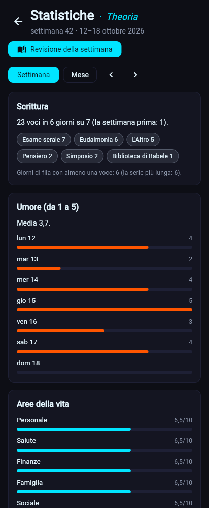

# Statistiche e revisioni · Theoria (dalla 0.1.4)

*Theoria* viene dal greco *theorein*, guardare e contemplare. Sono i numeri di una settimana o di un mese, calcolati dalle voci sul dispositivo, e la **revisione** già compilata da rileggere.

## Cosa si calcola
| Parte | Da dove viene |
|---|---|
| **Scrittura** | quante voci, in quanti giorni del periodo, per modello; i giorni di fila con almeno una voce |
| **Umore (da 1 a 5)** | ogni blocco *scelta* con valori (l'umore di mattina e sera), riportato da 1 a 5 qualunque sia la sua scala; per giorno nella settimana, per settimana nel mese; la tendenza rispetto al periodo prima |
| **Aree della vita** | i blocchi *scala* che si chiamano come le 8 aree (personale … svago), o tutte le scale di un modello che ne ha almeno 4: la media di ognuna, la più alta e quella che chiede più cura |
| **Altri punteggi** | le altre scale (il voto alla giornata, l'energia del mattino …) |
| **Collezioni** | le voci con un blocco *progresso* in corso o in pausa, e quelle completate nel periodo |
| **Persone più presenti** | le persone collegate più spesso dalle voci del periodo |
| **Ancora aperti** | le voci delle liste non spuntate (per esempio "Cose da fare domani"), finché una voce dopo non le spunta |

Tutto si riconosce dal **tipo di blocco** e dalle sue opzioni, non da nomi fissi: funziona con i pacchetti pronti e con i modelli fatti dall'utente. Le voci di revisione (settimana, mese, anno) non entrano nei numeri della revisione stessa.

Le parole non giudicano mai: "un po' più giù della settimana prima", mai un rimprovero. Quando tutte le aree hanno lo stesso punteggio, nessuna "chiede più cura".

## La revisione già compilata
La revisione della settimana (*Hypomnemata*) e del mese (*Lettera a Lucilio*) del pacchetto Stoa · Diario si possono preparare dai numeri del periodo:
- il **voto** viene dalla media dei voti alle giornate (o dall'umore, se mancano i voti);
- l'**area su cui concentrarsi** è quella più bassa;
- gli **obiettivi** sono le cose ancora aperte;
- i **momenti belli** e **cosa ho imparato** sono le frasi delle voci del periodo, con il giorno.

È una bozza da rileggere: i momenti difficili li scrive solo l'utente. Una revisione per periodo: se c'è già, si apre quella.

## Dove si usa
- **App**: **Oggi → Statistiche**. Settimana o mese, con le frecce per i periodi passati; il pulsante **Revisione della settimana** (o del mese) prepara la voce e apre il modulo per completarla. Ogni collezione, persona o cosa aperta si tocca per aprire la sua voce.
- **CLI**: `zbone stats` (settimana; `--month`, `--date`, `--html`) e `zbone review week|month` (`--save` per salvarla, `--html` per la pagina con i grafici) ([guida rapida](../utente/guida-rapida.md#statistiche-e-revisioni--theoria)).
- La pagina HTML è un file solo, senza internet, con i grafici in SVG.

## Codice
- `core/stats.py`: periodi, umore, scale, scrittura, collezioni, cose aperte, persone, revisione e proposta, pagina HTML. Solo funzioni pure, con `today` sempre passato.
- `ui/views/stats.py` e `ui/viewmodels.py` (`load_stats`, `move_period`, `prepare_review`); `cli/stats_cmd.py`.
- Test: `tests/test_stats.py`, `tests/test_cli_insights.py`, `tests/test_ui_viewmodels.py`, `tests/test_ui_views.py`.
