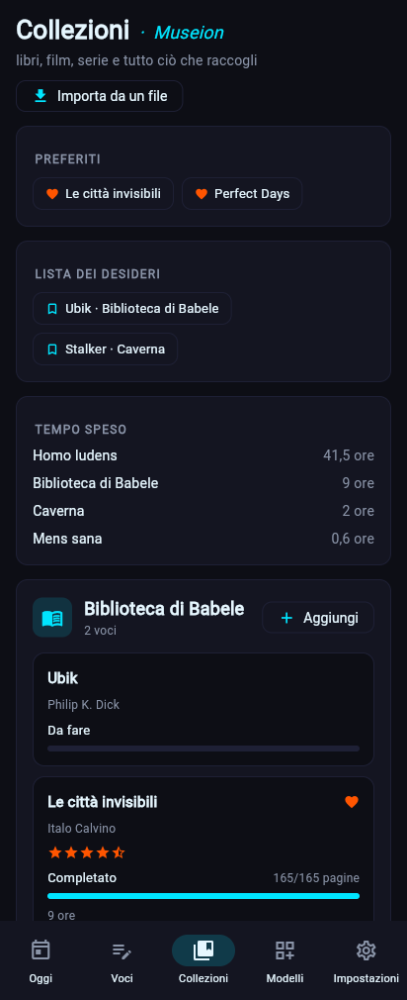

# Svago avanzato · Museion (dalla 0.2.5)

Libri, film, serie, anime, videogiochi e giochi da tavolo ([Museion · Collezioni](../utente/guida-rapida.md#modelli-pronti)) imparano a tenere il conto di quando li hai iniziati e finiti, a dare mezzi voti, a nascondere gli spoiler, a segnare i preferiti, a ricordare quanto tempo ci hai passato e a portare con sé quello che avevi già segnato su Goodreads, Letterboxd, MyAnimeList e Steam. I modelli di Museion passano alla **1.2.0**: le voci di prima restano valide.

## Voto a mezzi punti
Il blocco **Voto a stelle** (`rating`) ha l'opzione `half`: con quella il voto va anche a mezzi punti (`8,5`). Nel modulo si tocca una stella per darla intera, di nuovo per mezza, una terza volta per toglierla; da terminale si scrive `4,5` (o `★★★½`).

Museion mette `half` al voto di tutte le raccolte, ma **resta a 5 stelle**: cambiare il massimo a 10 darebbe un altro significato ai voti già scritti (un 4 su 5 diventerebbe un 4 su 10). Chi vuole l'8,5 su 10 imposta *Stelle* a 10 nell'editor del modello, a partire dai voti nuovi.

## Recensione con spoiler
Il blocco **Testo lungo** ha l'opzione `spoiler`: nella pagina della voce il testo resta nascosto dietro «contiene spoiler · Mostra» finché non lo apri. Libri, film, serie, anime e videogiochi hanno la *Recensione con spoiler* accanto alla *Recensione*. Il testo si nasconde solo nella pagina della voce: la ricerca e le esportazioni lo contengono, come ogni altro testo.

## Preferiti
Un blocco nuovo, **Preferito** (`favorite`, *Philia*, dall'amore per ciò che si sceglie per sé): un cuore che si accende o no. Le voci preferite hanno il cuore sulla scheda e stanno nel riquadro **Preferiti** delle Collezioni. In terminale: `--set preferito=sì`.

## Inizio e fine
Il blocco **Avanzamento** scrive da solo il giorno in cui si inizia e quello in cui si finisce, quando ne cambia lo stato:
- *In corso*, *In pausa*, *Completato* o *Abbandonato* senza una data di inizio: inizio = oggi.
- *Completato*: fine = oggi. Se si torna a *In corso* la fine si toglie, e la prossima volta se ne scrive una nuova.
- Solo un **cambio di stato** scrive una data: modificare la recensione di un libro finito nel 2019 non lo fa «finire oggi».
- Le date già scritte non si toccano (il modulo salva solo stato e contatore, e le date restano). Nella pagina della voce si leggono sotto la barra: «iniziato 1 settembre 2026 · finito 3 ottobre 2026».
- Le voci portate con un import ricevono le date del file, e **nessuna** inventata: un libro finito nel 2019 non risulta iniziato oggi.

Non c'è ancora un modo di correggere una data a mano.

## Lista dei desideri e tempo speso
- Lo stato *Da fare* (`wishlist`) di ogni raccolta è la lista dei desideri: le Collezioni la raccolgono in un riquadro, **Lista dei desideri**, con la raccolta di ognuno.
- Il riquadro **Tempo speso** somma, per raccolta, i blocchi numero misurati in ore (o minuti): *Ore di lettura* nei libri, *Ore di visione* in film, serie e anime, *Ore di gioco* nei videogiochi e nei giochi da tavolo. Ogni scheda mostra le sue ore.

## Importare da un file
Da **Collezioni → Importa da un file** (o `zbone importa FONTE FILE`): scegli il servizio, il file, vedi quanti elementi verrebbero aggiunti e conferma. ZibaldOne legge **solo il file che gli dai**: non si collega ai tuoi account né alle loro API ([requisiti, punto 2](requisiti-v0.2.md)). Servono i modelli di Museion (`zbone pack install collezioni`).

| Fonte | Il file | Diventa |
|---|---|---|
| **Goodreads** | il CSV di *My Books → Import and export → Export Library* | Libri: titolo, autore, voto, stato (letto / sto leggendo / da leggere), pagine, date di lettura, scaffali come etichette (`favorites` = preferito), recensione (con spoiler se segnata), ISBN |
| **Letterboxd** | un CSV dello zip di *Export your data*: `ratings`, `reviews`, `diary`, `watched` o `watchlist` | Film: titolo, anno, voto (anche mezze stelle), data in cui l'hai visto, recensione, etichette; `watchlist` va nella lista dei desideri |
| **MyAnimeList** | l'XML dell'elenco anime (va bene anche `.xml.gz`) | Anime: titolo, stato, episodi visti e totali, date, voto, commento |
| **Steam** | un JSON con i giochi posseduti (`GetOwnedGames` dell'API di Steam, con `include_appinfo=1`) | Videogiochi: titolo, piattaforma «Steam», ore giocate, ultimo giorno di gioco |

Cose da sapere:
- **Doppioni**: una voce con lo stesso titolo (e, per i libri, lo stesso autore; per i film, lo stesso anno, se entrambi lo dicono) è già presente e si lascia com'è: importare due volte lo stesso file non aggiunge niente, e non aggiorna le voci esistenti. Con Letterboxd conviene partire da `ratings` o `reviews`, che hanno il voto, e poi `watched` e `watchlist`.
- **Voti di MyAnimeList** (0-10) diventano mezzi punti su 5 (8 → 4, 9 → 4,5).
- **Steam** non ha un'esportazione: il file è la risposta dell'API per il tuo account (serve una chiave API che crei tu su Steam). Un gioco mai avviato resta «Non iniziato».
- **Non importati**: i manga di MyAnimeList, le liste personalizzate di Letterboxd, le immagini di copertina.
- Un file di un altro servizio, o troppo grande (50 MB), viene rifiutato con il motivo, senza scrivere niente. `--prova` (terminale) conta soltanto.

## Terminale
| Comando | Cosa fa |
|---|---|
| `zbone importa goodreads goodreads_library_export.csv --prova` | quanti libri verrebbero aggiunti, senza scrivere |
| `zbone importa letterboxd ratings.csv` | aggiunge i film |
| `zbone importa myanimelist animelist.xml.gz` | aggiunge gli anime |
| `zbone importa steam giochi.json` | aggiunge i videogiochi |
| `zbone entry add libro --set voto=4,5 --set preferito=sì` | un voto a mezzi punti e un preferito da terminale |

## Codice
- `core/blocks.py` (`RatingBlock.half`, `LongTextBlock.spoiler`, `FavoriteBlock`, date nell'avanzamento), `storage/database.py` (`_stamp_progress`, `add_entry(stamp=)`).
- `core/importers.py` (lettura dei quattro formati e scrittura), `cli/import_cmd.py`, `ui/views/import_dialog.py`, `ui/views/collections.py`, `ui/viewmodels.py` (`hours_of`, `favorites_of`, `wishlist_of`).
- Test: `tests/test_recreation.py`, `tests/test_ui_views.py`, `tests/test_ui_logic.py`.
